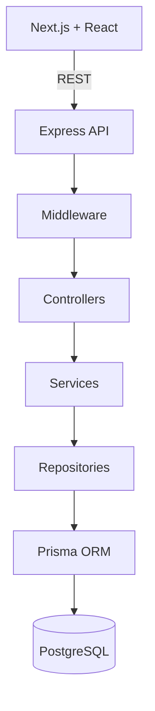

# TaskForge

TaskForge is an original project-management application for software teams. It is inspired by common issue-tracking workflows without using proprietary branding, code, or assets.

## Current status: Stabilization in progress

The repository currently contains the production-oriented foundation:

- npm-workspaces monorepo with separate Next.js web and Express API apps
- strict TypeScript configuration
- Prisma schema connected to PostgreSQL
- environment validation with Zod
- baseline Helmet, CORS, JSON limits, and centralized API error handling
- Docker Compose files retained for later deployment work
- API liveness endpoint at `GET /api/health` and database readiness endpoint at `GET /api/health/ready`
- User registration and login with bcrypt password hashing
- JWT access tokens in secure HTTP-only cookies
- Bearer-token support for non-browser API clients
- Protected `GET /api/auth/me` endpoint and logout flow
- Zod request validation and authentication rate limiting
- Repository/service/controller separation for authentication
- Authentication API tests covering invalid, expired, malformed, and unsafe requests
- Workspace creation and workspace membership management
- Workspace-level OWNER, ADMIN, and MEMBER authorization
- Server-enforced workspace isolation and owner protection
- Workspace/RBAC API tests using mocked repositories
- Project creation and workspace-scoped project access
- Task creation with transactional project numbering and identifiers such as `WEB-42`
- Task status, priority, type, reporter, and assignee fields
- Paginated task listing with database-level filters
- Project/task authorization and API tests
- Kanban board grouped by task status
- Persisted task positions and transactional reordering
- Drag-and-drop task movement with dnd-kit
- Optimistic board updates with rollback on API failure
- Sprint creation and project sprint history
- Planned, active, and completed sprint lifecycle
- Database-enforced single active sprint per project
- Cross-project-safe task sprint assignment
- Task comments with author editing and owner/admin moderation
- Structured activity history for task and comment changes
- Transactional comment mutations with matching audit records
- Paginated task comments and activity timelines
- Owner-only workspace deletion with explicit confirmation in the UI
- Account menu with logout and clean account switching through login
- Workspace-member-only task assignee selection and unassignment
- Hardened sprint assignment and lifecycle behavior
- Hardened Kanban persistence with optimistic rollback and serialized moves

## Session persistence and troubleshooting

- Login/register set an HttpOnly cookie whose lifetime matches the signed access token. Reloading the page restores the account through `GET /api/auth/me`; no JWT is stored in localStorage.
- Shared client session state preserves the known account during navigation and transient network, 429, or server errors. A confirmed 401 or successful logout clears it. Stale requests cannot overwrite a newer login or logout.
- Only registration and login consume the credential-attempt rate limit. Account reads and logout do not.
- Access tokens still expire after `JWT_EXPIRES_IN` (default `15m`). There is no refresh-token flow yet: expiry requires signing in again. This is distinct from a navigation-related false sign-out.
- Use the same hostname consistently (for example `http://localhost:3000`); cookies and CORS depend on the configured origins. Production requires HTTPS for Secure cookies.

For local development, run `npm run dev`: the API watcher and Next.js development server reload source changes automatically.

Session regression checks:

```bash
npm test --workspace @taskforge/api
npm test --workspace @taskforge/web
```

Tests cover repeated account reads beyond the login rate-limit budget, token expiry, error recovery, concurrent requests, and stale responses after account changes. Full browser verification remains separate from these tests.

## Architecture



## Requirements

- Node.js 24+
- npm 11+
- PostgreSQL 16+ installed and running natively (including the `psql` client)

## Local setup

Local development and testing use Node.js and native PostgreSQL. No container runtime is required.

1. Install the requirements and start your local PostgreSQL service using your operating system's service manager. Confirm that it listens on `localhost:5432` (or use its actual port in `DATABASE_URL`).
2. As your PostgreSQL administrator, create a dedicated login and database. For example, open `psql -U postgres -d postgres` and run:

   ```sql
   CREATE ROLE taskforge_dev LOGIN;
   \password taskforge_dev
   CREATE DATABASE taskforge OWNER taskforge_dev;
   ```

   The `\password` prompt sets a password without placing it in command history. For developers who will **create new migrations** with `db:migrate`, also run `ALTER ROLE taskforge_dev CREATEDB;` so Prisma can create its shadow database. Applying committed migrations with `db:deploy` does not need this privilege.

3. Copy `.env.example` to `.env` in the repository root (`Copy-Item .env.example .env` in PowerShell, or `cp .env.example .env` in a POSIX shell). Replace the database user/password placeholders with your local role and password. URL-encode special characters in the password when putting it in `DATABASE_URL`. Replace `JWT_SECRET` with a random value of at least 32 characters. For example, generate one locally with `node -e "console.log(require('node:crypto').randomBytes(32).toString('hex'))"`.
4. From the repository root, install dependencies, generate the client, apply the committed migration history, and start development:

   ```bash
   npm install
   npm run db:generate
   npm run db:deploy
   npm run db:status
   npm run dev
   ```

The web app runs at `http://localhost:3000`; the API runs at `http://localhost:4000`.

The supervisor starts both servers using the current Node executable on Windows, macOS, and Linux. Ctrl+C stops both server trees; if either server exits, the other is stopped and the originating exit status is returned. Keep ports 3000 and 4000 available, and use the configured hostname consistently.

The dev supervisor and every database command explicitly load the root `.env`; existing process environment variables take precedence. Prisma runs from `apps/api` to find its schema and migrations. API workspace database scripts use the same wrapper. For schema changes, create a migration against your development database:

```bash
npm run db:migrate -- --name describe_your_change
npm run db:generate
```

Use `db:deploy` for existing migrations and `db:status` to inspect their state. Avoid `db:push` for normal setup: migration history includes database constraints that schema synchronization alone does not reproduce. If an existing database was previously initialized with `db:push`, do not blindly reset it; preserve its data and reconcile/baseline its migration history first.

The authentication endpoints are:

```text
POST /api/auth/register
POST /api/auth/login
POST /api/auth/logout
GET  /api/auth/me
```

Workspace endpoints are protected by authentication:

```text
POST   /api/workspaces
GET    /api/workspaces
GET    /api/workspaces/:workspaceId
GET    /api/workspaces/:workspaceId/members
POST   /api/workspaces/:workspaceId/members
DELETE /api/workspaces/:workspaceId/members/:userId
```

Project and task endpoints are also protected:

```text
POST   /api/workspaces/:workspaceId/projects
GET    /api/workspaces/:workspaceId/projects
GET    /api/projects/:projectId
POST   /api/tasks
GET    /api/tasks?projectId=...&page=1&limit=20
GET    /api/tasks/:taskId
PATCH  /api/tasks/:taskId
DELETE /api/tasks/:taskId
```

Kanban endpoints:

```text
GET   /api/projects/:projectId/board
PATCH /api/tasks/:taskId/status
PATCH /api/tasks/:taskId/position
```

Task positions are stored as integers scoped to a project/status column. Cross-column moves update status and position in one transaction; same-column moves compact affected positions to keep ordering stable.

Sprint endpoints:

```text
POST  /api/projects/:projectId/sprints
GET   /api/projects/:projectId/sprints
PATCH /api/sprints/:sprintId
POST  /api/sprints/:sprintId/start
POST  /api/sprints/:sprintId/complete
```

Sprint lifecycle transitions are enforced on the server. Only planned sprints can start, only active sprints can complete, completed sprints are immutable, and a partial unique index prevents multiple active sprints in one project.

Task detail, comment, and activity endpoints:

```text
GET    /api/tasks/:taskId/comments?page=1&limit=20
POST   /api/tasks/:taskId/comments
PATCH  /api/comments/:commentId
DELETE /api/comments/:commentId
GET    /api/tasks/:taskId/activities?page=1&limit=20
```

Activity records store structured metadata rather than only display text. For example, a status change stores `{ "from": "TODO", "to": "IN_PROGRESS" }`, while comment events store `{ "commentId": "..." }`.

## Stabilization milestone

Before adding search or dashboards, verify the existing workflows against local PostgreSQL: registration, workspace/project/task creation, sprint assignment, comments/activity, and owner workspace deletion. The account menu logs out through the API and clears browser state before redirecting to login. The board uses persisted position APIs and rolls optimistic moves back when persistence fails.

Task filtering is performed by the API/database rather than downloading all tasks to the browser. Supported filters include `status`, `priority`, `type`, and `assigneeId`.

Workspace creation runs in a database transaction so the creator and their `OWNER` membership are created atomically. Membership uniqueness is enforced with a composite database constraint on `(workspaceId, userId)`.

The browser receives an HttpOnly `taskforge_access_token` cookie. The API also accepts the same JWT as an `Authorization: Bearer <token>` header for API clients. Refresh tokens are intentionally deferred until the session model is needed by a later phase.

## Docker (later deployment)

The Dockerfile and Compose configuration are preserved for later deployment work. They are not part of the current local setup or testing workflow. Before deployment, configure production secrets, HTTPS/cookie behavior, origins, database migrations, and persistent storage for the target environment.

## Environment variables

See `.env.example`. Never commit `.env` or real secrets. `JWT_SECRET` is validated as a minimum 32-character value by the API.

## Checks

```bash
npm run test:scripts
npm test --workspace @taskforge/api
npm test --workspace @taskforge/web
npm run typecheck
npm run build
npm run lint
npm run format:check
```

The supervisor tests use simulated child processes and do not start servers or access the database. After automated checks, run the app against native PostgreSQL and verify registration/login, workspace/project/task creation, board movement, sprints, comments/activity, and logout in the browser.

## Roadmap

### Phase 9 — Project dashboard

Open **Dashboard** in the project header. The board remains the default view. The dashboard shows total/TODO/IN_PROGRESS/DONE counts, status distribution, active sprint progress, eight recently updated tasks and eight recent activity records. Empty projects and projects without active sprints have explicit empty states. Data refreshes on page load or manual refresh; this is not a real-time dashboard.

`GET /api/projects/:projectId/dashboard` requires workspace membership and returns project metadata, summary counts, active sprint progress, recent tasks and recent activity. Counts are database aggregates rather than counts of a paginated task list. The repository uses a repeatable-read transaction for a consistent read, deterministic ordering and bounded recent lists. Only public user fields are selected. An empty active sprint has zero progress.

Phase 9 verification: **62 backend unit/API tests, 85 frontend tests, 21 real PostgreSQL integration tests and 8 Chromium browser scenarios passed**. Tests use invocation-owned schemas; development data is not reset.

### Phase 8 — Implemented search and filters

The board searches task titles/descriptions case-insensitively and exact identifiers such as `WEB-42`. Combine status, priority, type, assignee, and sprint filters; selections and pagination survive reloads and browser history. Membership authorization applies before querying.

`GET /api/tasks/search` and `GET /api/tasks` accept `projectId`, `q`, `status`, `priority`, `type`, `assigneeId`, `sprintId`, `page`, and `limit`. Use `assigneeId=unassigned` or `sprintId=backlog` for null assignments. The board endpoint accepts these queries with its project ID in the path. Page size defaults to 20 and is bounded at 100.

Queries use Prisma database filtering, stable ordering, and repeatable-read list/count snapshots. Substring search can still scan project rows; trigram/full-text indexing is deferred until measured workloads justify it.

Dragging is disabled on filtered or partial boards to avoid reordering against hidden tasks. Clear filters and load the complete board to reorder. The API caps pages at 100 tasks; larger boards remain paginated and do not support complete-board reordering in this version.

### Local verification milestone

Run database-backed regression tests with native PostgreSQL running and root `.env` configured:

```bash
npm run test:integration
```

The runner creates a randomly named test schema, applies all migrations, exercises real Express/Prisma calls, and removes only that invocation's schema afterwards. It never resets the development database. The configured role needs permission to create schemas.

Browser regression setup (one-time Chromium download):

```bash
npx playwright install chromium
npm run test:e2e
```

The browser runner uses another temporary database schema and dedicated local servers on ports **3100/4100**. It refuses to reuse occupied ports and uses `.next-e2e` output so normal development on **3000/4000** can continue. It shuts down its own servers and removes test data when the run ends. No Docker is needed. Authentication traces, screenshots, and videos are disabled by default.

Current evidence: 16 real-database integration scenarios and seven Chromium browser scenarios passed. Browser tests cover search/filter/pagination history, session reload/navigation/logout, complete task creation, pointer drag/reorder persistence, member restrictions, sprint lifecycle, and confirmed task/workspace deletion. Playwright uses full Chromium in headless mode (`channel: "chromium"`): the separate headless-shell executable failed to spawn on this Windows installation, while full Chromium launched successfully. No personal browser profile is used.

Development and testing remain local with native PostgreSQL. Docker configuration is retained for optional deployment later.

1. **Stabilization gate — implemented:** browser-level Playwright tests and isolated PostgreSQL integration tests for core workflows. Continue extending these tests for each feature.
2. **Phase 8 — implemented:** project-scoped search, combined filters, visible pagination, and URL-preserved state, with the ordering limitations documented above.
3. **Phase 9 — implemented:** project dashboard totals, active sprint progress, recent tasks/activity, responsive layout and accessible progress indicators backed by real database queries.
4. **Phase 10 — Security and resilience:** review authorization and concurrency with real database tests, dependency audit, error/timeout behavior, and a deliberate refresh-session design if persistent sign-in is needed. Current access tokens still expire without automatic renewal.
5. **Phase 11 — Deployment:** choose a host, then configure HTTPS, secrets, migrations, backups, health/readiness checks and optional Docker images. Do not replace the local development workflow.
6. **Phase 12 — Portfolio documentation:** complete API reference, architecture/database diagrams, setup and demo instructions, and interview trade-offs supported by implemented behavior and measured tests.

### Cleanup policy

Remove code only after verifying it has no consumers, including configuration and tests. The obsolete task-list component, unreferenced shared ESLint/Prettier scaffolds, and unused Tailwind v3-style config were removed. Tailwind v4 remains configured through PostCSS/CSS. The legacy backlog URL redirects to the board. Working API endpoints and deployment files are retained even if the current UI does not call every endpoint.
